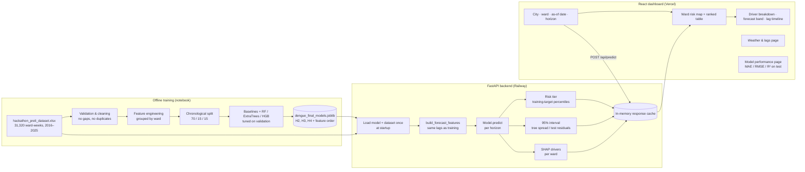

# Architecture: Dengue Early-Warning System

Forecasts weekly dengue cases for each of 60 wards in 5 Bangladeshi city corporations (Dhaka North, Dhaka South, Chattogram, Gazipur, Narayanganj) 2, 3 and 4 weeks ahead. Each forecast is converted to a risk tier (Low / Medium / High / Critical) so public-health officers can target larvicide and fogging teams before cases peak.

## 1. Data flow

## 2. Weather lag pipeline

All lag features are computed **per ward** with `groupby(ward).shift(k)` so no ward borrows another ward's history, and every rolling window is shifted by one week so the current week's values never leak in.

| Group | Features | Count |
|---|---|---|
| Weather lags | `avg_temp_c`, `max_temp_c`, `min_temp_c`, `rainfall_mm`, `relative_humidity_pct` at 1, 2 and 4 weeks | 15 |
| Weather rolling means | same 5 variables, 4- and 8-week windows | 10 |
| Dengue history | case lags 1, 2, 3, 4, 8, 12 weeks; rolling mean 2/4/8; rolling max 4/8 | 11 |
| Ward vulnerability | `water_logging_risk_index`, `population_density_sqkm`, `sanitation_score` | 3 |
| Calendar | year and sin/cos of month and week, for the as-of week and the target week | 10 |

Because the forecast is made 2–4 weeks ahead from weather lagged 1–4 weeks (plus 8-week means), the model sees rain from **3 to 8+ weeks before the target week**. That covers the Aedes breeding cycle (7–14 days) plus incubation and symptom onset. The same function (`backend/services/feature_engineering.py`) builds features at inference time, so training and serving cannot drift apart.

## 3. Chronological validation split

Random splits would let the model learn from future weeks, so the split is strictly by date:

| Split | Weeks | Purpose |
|---|---|---|
| Train | 2016-01-04 → 2022-12-26 (70%) | Fit candidate models |
| Validation | 2023-01-02 → 2024-06-24 (15%) | Choose model and hyperparameters |
| Test | 2024-07-01 → 2025-12-29 (15%) | Final, untouched evaluation |

After selection, each model was refit on train + validation and scored once on test. Risk-tier thresholds use only training targets; prediction intervals and feature importance use only the test window.

## 4. Model selection rationale

| Horizon | Selected model | Validation MAE | Test MAE | Test RMSE | Seasonal-naive MAE (val) |
|---|---|---|---|---|---|
| H2 (2 weeks) | Random Forest (tuned) | 0.966 | 1.309 | 2.379 | 1.661 |
| H3 (3 weeks) | HistGradientBoosting | 1.144 | 1.405 | 2.620 | 1.682 |
| H4 (4 weeks) | HistGradientBoosting | 1.243 | 1.495 | 2.838 | 1.705 |

- **Why tree ensembles:** the drivers interact non-linearly (heavy rain matters most in wards with poor drainage), case counts are zero-heavy (58% zeros), and there are only 49 tabular features. Trees handle all three without scaling or manual interaction terms, and SHAP can explain them exactly.
- **Why one model per horizon:** each horizon has its own target shift and target-week calendar features. A separate model lets each one pick the lags that matter at that range.
- **Why these winners:** chosen purely on validation MAE among seasonal-naive baselines, Random Forest, Extra Trees and HistGradientBoosting. Every ML model beats the best baseline by 23–41%. HistGradientBoosting also trains in about 2 s compared with about 220 s for the forest.
- **Risk tiers:** a predicted count is compared with the 50th, 80th and 95th percentiles of training targets for that horizon (Low ≤ p50 < Medium ≤ p80 < High ≤ p95 < Critical). The tier is a relative ranking; the score is a percentile rank, not a probability.
- **Uncertainty:** H2 uses the 2.5–97.5th percentile across forest trees. H3 and H4 add the 2.5–97.5th percentile of held-out test residuals. These are empirical intervals, not guaranteed coverage.

## 5. Compute and cost efficiency

| Control | Where |
|---|---|
| Serialized model (joblib) loaded **once** at startup; no retraining at request time | `services/forecast_service.py` |
| Dataset loaded once into a process-wide cache | `services/ward_service.py` |
| One batched `predict` and one batched SHAP pass for all wards in a request | `api/routes/compat.py` |
| Server-side response cache keyed by (city, ward, date, horizon), bounded at 256 entries | `api/routes/compat.py` |
| Test-set intervals, importance and metrics computed lazily once, then cached | `services/forecast_service.py` |
| Client cache with 5-minute TTL, de-duplication of in-flight requests, `AbortController` for stale requests, 400 ms debounce | `frontend/src/services/cache.js`, `hooks/useDebounce.js` |
| Lazy-loaded route pages and split vendor chunks | `frontend/src/App.jsx`, `vite.config.js` |
| **No paid APIs and no LLM calls** anywhere at runtime, so token cost is zero | n/a |

Inference for all 60 wards takes well under a second on a single CPU (0.1–0.5 s per horizon in the notebook's pipeline test).

## 6. Limits and next steps

- The dataset ends 2025-12-29, so the system runs in **replay mode**: forecasts can be made for any as-of date in the data that has 12 weeks of history. No live 2026 surveillance feed exists at ward level.
- Ward map positions are approximate (spread around each city's centroid); the dataset has no ward coordinates.
- Final sprint: ingest live weather (Open-Meteo, free and keyless), accept weekly case uploads from health offices, and retrain on a schedule.
